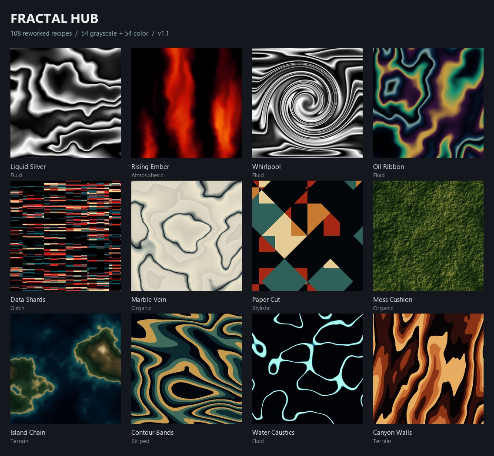

# Fractal Hub

A compact, dockable texture browser for **EffectCraft**. Version **1.1.0** includes **108 reworked recipes: 54 grayscale textures and 54 colored looks** in nine categories, native-rendered thumbnails, hover names, motion previews, favorites and one-step application to editable effects.

The revised library adds liquid folds, caustic networks, grain, geometric glitches, distressed materials, contours and terrain colors. Selected recipes combine noise with editable distortion, relief and custom Colorama palettes. 

## Install

1. In EffectCraft, choose **File → Scripts → Install ScriptUI Panel…**.
2. Select **`dist/Fractal Hub.jsx`** from this repository (or `Fractal Hub.jsx` from the downloaded release package).
3. Open **Window → Fractal Hub.jsx** and dock or float the panel.

**Updating:** close the existing panel, reinstall the updated JSX, and reopen it. If EffectCraft keeps the old script loaded, restart the app. Favorites retain their IDs; existing saved user presets remain compatible. Already-applied project effects change only when you apply a revised recipe.

The distributable is a **single self-contained JSX file**. Browsing and applying presets do not require external images, Node, Python, a web server, network access or script file permissions. Tested on EffectCraft **0.14.0 for Windows**, October 22, 2026. This uses EffectCraft's native command API and is not an After Effects script.

## Use

Open a composition. Select a thumbnail, then use the **double-chevron** to apply it to selected layers. **Double-clicking a thumbnail** does the same. Use **+** to create a new solid with the preset.

Preset names appear **over the thumbnail on hover** and in tooltips. Selected names appear above the grid. Move the pointer horizontally across a tile to scrub four native-rendered evolution frames. The play icon toggles motion previews.

| Control | Action |
| --- | --- |
| Search field | Search names and categories across the entire library |
| Category menu | Browse one category, all textures, or user presets |
| Category heading | Collapse or expand its grid |
| Star beside category menu | Show favorites only |
| Star beside selected name | Favorite the selected preset; Ctrl/Cmd-click a tile also works |
| Grid icon | Cycle 2, 3, 4 or 5 columns; use two for narrow docks |
| Dice | Randomize seeds on apply |
| Gear | Choose noise engine, replacement behavior, animation and scale options |
| Disk | Save the selected layer's noise settings as a user preset |
| Camera | Capture the current composition as the selected user preset's thumbnail |
| Trash | Remove a user preset after confirmation |

Categories: **Atmospheric, Fluid, Glitch, Granular, Grunge, Organic, Striped, Stylistic, Terrain**. `F/T` badges support either native engine. `FN` and `TN` indicate a fixed engine. Built-in images are rendered with **Fractal Noise**; choosing Turbulent Noise produces a related variation, not the identical thumbnail.

## Application and animation

- **Replace existing noise** replaces a selected noise effect, or the last native noise effect on each selected layer, together with its adjacent Fractal Hub finishing effects. The recipe's position is preserved, including when switching engines. Other effects remain intact. Existing noise animation is replaced by the chosen preset/animation options.
- **Add unless noise is selected** appends a complete recipe unless its noise, a managed finishing effect, or one of their properties is selected.
- **Still** uses the preset's base Evolution value. **Continuous** adds an Evolution expression in degrees per second. **Seamless loop** creates two native keyframes, enables Cycle Evolution and uses `loopOut("cycle")`. It begins at the composition's work-area start and repeats after the specified interval. Seamless loops require Fractal Noise.
- **Fit texture scale to layer** preserves the thumbnail's relative texture size using the target layer's shorter dimension. Disable it to use the stored native scale values. Non-square layers show a wider or taller region of the noise.
- Each application, including multi-layer application and new-solid creation, is one atomic, undoable operation. Locked or unsuitable layers cause a clear message before editing. If a native parameter fails, the entire application rolls back.

The recipes remain ordinary editable Fractal Noise or Turbulent Noise effects, with native Colorama, Turbulent Displace, Twirl or Emboss where used. Save your `.ecproj` normally. The panel supports both docked and floating use. EffectCraft supplies the panel scrollbars; column count is controlled by the grid icon.

Finishing effects are named `FH · Preset / …` directly after their noise. Keep these names and adjacency for automatic replacement and capture. Renaming or moving one out of its group makes it independent. Turbulent Displace's Random Seed has a generated constant expression so its instance ID cannot change the look. Remove that expression if you want to edit its native seed slider manually; the dice still randomizes the complete recipe.

## User presets

Select one layer containing a native noise effect, optionally select the exact effect or one of its properties, then click the disk. Fractal Hub saves its parameter values, engine, seed, relative texture scale and managed finishing effects, including custom palettes. It captures the evaluated flow seed for reproducibility; other expressions and animation curves are not copied. Choose animation again when applying. Names may be up to 64 characters; the user library holds up to 100 presets.

User presets, favorites and options live in EffectCraft's persistent `app.settings` under **Fractal Hub**, separate from project undo. New user presets display a placeholder until a thumbnail is captured. The camera captures the **whole current composition**, including other visible layers; it is a manually chosen reference image, not an isolated rerender of the saved effect. Save the project and enable **Settings → Scripting & Expressions → Allow Scripts to Write Files and Access Network** for this optional capture. The script creates a temporary PNG beside the project, embeds it in settings and removes the temporary file. It never enables file access itself or accesses the network.

## Preview compatibility and scope

The tested EffectCraft 0.14.0 desktop build exposes `app.scheduleTask` but does not service the panel's scheduled callbacks. **Pointer scrubbing is the verified motion-preview path** in that build. Timer-driven playback is also wired for hosts that service those callbacks; stationary-hover playback is not claimed as verified. Motion previews use four frames and are illustrative, not full-rate video. Preset names on hover work independently of animation.

Fractal Hub is an independent implementation of the workflow in [Fractal Noise Browser](https://aescripts.com/fractal-noise-browser/). Its preset library and assets are original. It does not include the vendor's presets, thumbnails or code, and is not a pixel-identical copy of their pack. It supports EffectCraft's two native noise engines; Curl Noise, `.ffx` import, external preview videos and nested user-preset folders are not included.

## Universal release

Download **Fractal Hub.jsx** or **Fractal-Hub-v1.1.0-universal.zip** from this repository's **Releases** page. The same self-contained JSX panel is used on Windows, Linux and macOS. The universal ZIP includes all three installation guides. No native library or architecture-specific binary is included.

| Platform | Package | Validation |
| --- | --- | --- |
| Windows | Universal JSX / ZIP | Tested with EffectCraft 0.14.0 |
| Linux | Universal JSX / ZIP | Uses EffectCraft's ScriptUI API; native execution unverified |
| macOS | Universal JSX / ZIP | Uses EffectCraft's ScriptUI API; native execution unverified |

Installation guides: [Windows](docs/INSTALL-Windows.md), [Linux](docs/INSTALL-Linux.md), [macOS](docs/INSTALL-macOS.md).

EffectCraft documents the shared ScriptUI panel installation mechanism and platform settings directories in its [extension documentation](https://github.com/storytold/effectcraft/blob/main/docs/plugins.md).

## Source and build

The source lives in **src/library.js**, **src/core.js** and **src/panel.js**. Original native-rendered preview frames are in **assets/frames/**. With Node.js installed, run **node build.mjs** to rebuild the self-contained panel at **dist/Fractal Hub.jsx**. No npm dependencies are required. Node.js is not required to use the panel.

Release validation on Windows covered every recipe, both noise engines where supported, recipe replacement, undo, rollback, saved-preset reproduction, loops, gallery interactions and all 432 preview frames. Linux and macOS are not claimed as tested.

## License

Original code, presets, icons and generated thumbnails: MIT. See [LICENSE](LICENSE) and [ATTRIBUTION.md](ATTRIBUTION.md).
